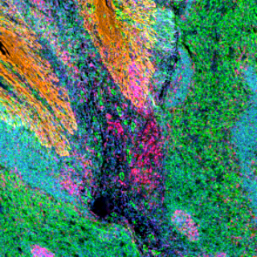

# Example image

`tonsil31_crop.ome.tif` is a 1 mm by 1 mm piece (1971 x 1971 pixels, 0.5074 micrometers per pixel) of a
31-antibody plus DAPI tonsil scan: 32 channels, 8-bit, compressed, about 83 MB. It is not stored in this
repository. It will be published as the release file `example-data-v1` (not uploaded yet), and `pqe --download-example` (or the
**Try the example** button) fetches it and checks its checksum.

## Where the piece comes from

Region: top edge `y0 = 14760`, left edge `x0 = 4428` (pixels of the full scan `Tonsil31plex_Scan1.qptiff`).

How it was chosen: `scripts/score_example_regions.py` scored 1344 candidate 1 mm regions on a coarse copy of the
scan, for tissue coverage, follicle (CD20 with CD21), T zone (CD3e outside follicles), epithelium
(Pan-Cytokeratin), TOX, CD163, and how closely CD163's fine pattern follows TOX's (the TOX to CD163
carryover). This region scored best (tissue 0.97, follicle 0.13, T zone 0.17, epithelium 0.12, TOX 0.36,
CD163 0.37, carryover 0.61). All scores and the next nine regions are in `example_region_scores.json`; the
checksum, size, coordinates and the command that made the file are in `example_data.json`.

(`tonsil31_crop_preview.png`: B-cell follicles in green, T zone in red, epithelium in orange.)

The check that matters is the tool itself. On this piece `pqe` finds 61 tissue windows and flags TOX to CD163
(a true carryover: TOX and CD163 share a fluor in neighboring cycles). Pairs with CD21 are not tested here:
CD21 is near-blank in this section (its brightest 0.5% of pixels is 3 of 255), and near-blank channels are left
out of the crosstalk check by rule. A pair that was tested and came out clean is CD3e to CD38 (same cycle,
both channels bright): its texture match is 0.11 against a cut-off of 0.31 and its spill asymmetry is 0.05
against 0.15, in both directions. See the main README for how to run it.

## Make it again

    python scripts/make_example_crop.py --qptiff Tonsil31plex_Scan1.qptiff --y0 14760 --x0 4428 --size-um 1000 --out examples/tonsil31_crop.ome.tif

With the same package versions (tifffile and imagecodecs, recorded in `example_data.json`) the output is the
same bytes (compare the sha256 it prints with `example_data.json`). A different tifffile or zlib build can write
different bytes for the same pixels; the checksum of the published file is the one that counts.

The preview picture is made with `scripts/make_example_preview.py --image examples/tonsil31_crop.ome.tif --out examples/tonsil31_crop_preview.png`.

## What the judge found on this piece

`tests/test_judge_example.py` writes known faults into this piece's pixels (see the main README, "Check the
checker"). Dimmed and over-exposed channels are called correctly, a 10% carryover of CD4 into FOXP3 in the next
cycle is flagged, and nothing else is flagged that was not flagged on the unmodified piece.

One miss, kept visible: 10% of ICOS written into MPO in the same cycle is **not** flagged. Their texture match
rises from 0.134 to 0.298 (cut-off 0.332) and their spill asymmetry from -0.005 to 0.055 (cut-off 0.147). The
cut-offs were not changed to make the check pass; the test is marked as an expected failure because this is a known sensitivity
limit, not a change waiting to be made; the cut-offs stay as they are. (The brief's pair, CD20 into CD31, could not be used: CD31 is near-blank
in this section, and near-blank channels are left out of the crosstalk check by rule.)

How weak a same-cycle leak can be before it is caught is measured in `docs/crosstalk_dose_series.csv` and
explained in `docs/how_to_read_results.md` ("What the crosstalk check can miss"): on this piece, 10% of the
source was not flagged and 20% was, for a dim target (ICOS into MPO) and for a bright one (CD3e into CD38). The
cut-offs were not changed.
